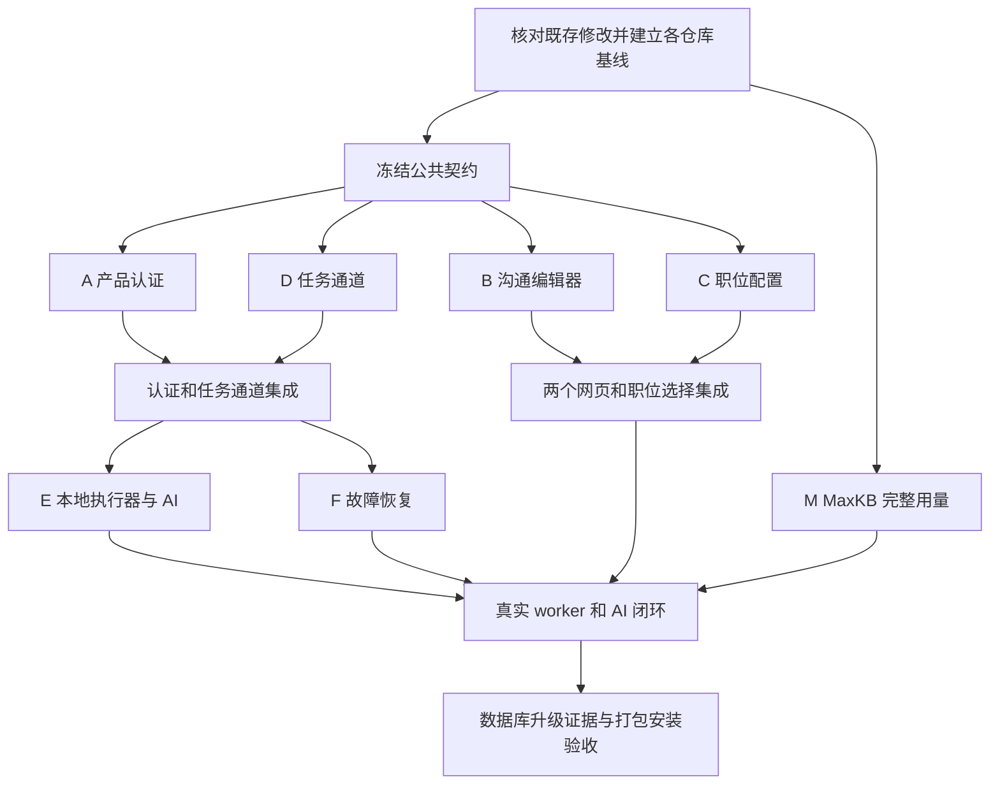

# BelloBuddy 接入 DPin 并行开发计划

制定日期：2026-10-06（Asia/Shanghai）。本次交付为并行实施规划，尚未创建开发 worktree、启动其他 agent、提交既存修改或执行集成测试。

依据：同目录的《BelloBuddy接入DPin需求文档》《BelloBuddy接入DPin技术实现路径》《BelloBuddy接入DPin实施进度清单》，以及本次对三个仓库 Git 状态、现有路由和客户端代理／网关接口的只读核对。需求和技术路径确定产品约束；2026-10-06 进度清单确定已经做过的工作及验证边界。

## 1. 总体安排

建议配置：1 名集成负责人 + 4 名 BelloBuddy 开发 agent。如果可以增加并发，再增加 1 名 MaxKB agent；它在另一仓库工作，可以独立推进。集成负责人可以同时承担 DPin 回归和联调准备，不需要另开一个重复开发后端业务接口的 agent。

第一轮：A 产品认证、B 沟通编辑器、C 职位配置、D 任务通道并行。可选的 M MaxKB 用量同时推进。

第二轮：在认证和任务通道合入后，释放的 agent 分别承担 E 本地执行器与 AI、F 故障控制与恢复。E、F 可以先阅读代码和准备契约测试，但正式接线依赖第一轮接口。集成负责人持续合并、构建和验证真实页面。

最后一轮：真实 AI 及记账闭环、数据库升级验收、正式打包与安装。外部分发所需的签名证书和公证权限单独记录，不能把本地包称为正式分发完成。

## 2. 开工前必须统一基线

本次实际核对：

| 仓库／位置 | Git 基线 | 当前状态与影响 |
| --- | --- | --- |
| 当前 Orca DPin worktree：`/Users/a1/orca/workspaces/DPin-backend-newapi/究极改造计划` | `d9eea01` | 与桌面主工作区不在同一提交；当前目录结构也不同，不能直接当作已有接入成果的基线 |
| DPin：`/Users/a1/Desktop/DPin-backend-newapi` | `77d12a6` | 配置服务、AI 桥接、管理前端等存在大量已修改及未跟踪文件 |
| BelloBuddy：`/Users/a1/Desktop/bosscli/recovery/BelloBuddy` | `6adabb6` | 认证代理、任务网关、方案服务、编辑器等大量成果尚未提交，普通新 worktree 不会自动继承 |
| MaxKB：`/Users/a1/Desktop/MaxKB-2` | `68b81ec` | 本次 `git status --short` 无输出；实际用量辅助模块已被 Git 跟踪。干净工作区不代表长期记忆用量问题已解决 |

统一基线由集成负责人执行：

1. 分别审查 DPin 和 BelloBuddy 的既存 diff 与未跟踪文件，区分接入成果、用户其他修改、临时产物及秘密文件。
2. 将需要继续开发的源码整理为各仓库的本地基线提交，记录提交 SHA。保留沟通编辑器未完成状态，不把施工源码写成已验证功能。
3. 数据库、刷新凭据、环境文件、应用 Key、日志和依赖目录不进入基线。不得用全量暂存掩盖未跟踪内容审查。
4. 在各真实仓库建立集成分支和任务分支，明确从记录的基线派生。Orca 中的父子关系不等于 Git 基线；创建后逐个核对 SHA 和必需文件。
5. 本文标注的原工程路径用于定位。开发 agent 必须修改自己的 worktree，不能回到桌面原目录写代码。

已有未提交成果未纳入基线前，不派发实现任务。当前 Orca worktree可以承担规划；实际集成应建立在正确的桌面工程基线上。

## 3. Worktree 分工与验收

以下分支名称是建议名称，尚未创建。模块完成和正式入口完成分别记录。

| 编号 | 仓库／建议分支 | 负责范围 | 独立验收 | 合入依赖 |
| --- | --- | --- | --- | --- |
| I | 各仓库的集成分支 | 基线、公共契约、共享文件接线、合并、整体验收及进度记录 | 实际客户端链路、受影响构建与回归 | 始终保留 |
| A | BelloBuddy／`bb/dpin-auth` | 工作台和设置产品状态适配、统一认证状态与任务准入、退出／失效通知 | 未登录和失效拒绝准入，重启验证恢复，迟到结果不恢复身份 | 统一基线 |
| B | BelloBuddy／`bb/communication-editor` | 完成沟通网页、字段映射、无损草稿、云端列表和保存 | 往返保留字段，冲突与失败保留内存草稿，页面独立构建 | 统一基线；复用已有方案接口 |
| C | BelloBuddy／`bb/job-config` | 账号／职位同步、云端方案选择、单职与批量保存、旧引用迁移 | 保存／重开、事务失败、特殊模式及下拉框数据源 | 统一基线；复用已有认证和方案服务 |
| D | BelloBuddy／`bb/task-channel` | 认证宿主到 daemon／worker 的受控通道、启动配置传递、持久化白名单 | 未授权通道拒绝、配置注入前不执行、重启重取、不落盘正文 | 统一基线；认证事件契约 |
| M | MaxKB／`maxkb/complete-usage` | 长期记忆等额外调用的实际用量归集、严格失败语义 | 主调用及额外调用均有可追溯真实用量，缺失／重复／非法数量拒绝 | MaxKB 基线；与 DPin 协议兼容 |
| E | BelloBuddy／`bb/execution-ai` | 内存方案驱动本地筛选和沟通、JEV／MaxKB、动作去重与回执 | 故障不误淘汰，本地停止不调用 AI，正确职位方案和发送状态 | A、D 契约稳定；真实端到端另依赖 C、M |
| F | BelloBuddy／`bb/recovery` | 分类暂停、探测／退避、会话权限检查、安全恢复、HUD 状态 | 断连恢复可续跑；主动暂停／停止／账号切换不被旧探测重启 | A、D 合入；与 E 共用动作许可契约 |

如仅有 3 名开发 agent：先运行 A、B、D；A 完成后转 C，D 完成后转 E，随后安排 F。不要因 agent 数量有限退回完全串行。

## 4. 文件所有权，避免同时编辑恢复产物

### 集成负责人独占

以下是高冲突文件，开发 agent 提交精确接线说明，由 I 修改：

- `app/src/main/index-BYEqD--t.js`：真实 IPC、产品登录和批次入口。
- `app/src/main/index-CcSlIXko.js`：真实 worker 入口。
- `app/src/main/mainWindow-C0zp7F7S.js`、`index.js`、`bootstrap.cjs`、`loader-OM0zjlIw.js`、`offline-policy.cjs`：窗口与启动总接线。
- `app/src/main/dpin-app-host.cjs`：统一宿主、账号 IPC、编辑器和任务服务注册。
- `app/src/renderer/assets/index-C9ubNdld.js`、`index-CGQ68GrN.js`、`index-CcCLgdWP.js`：恢复版看板、账号区、方案来源、职位页面和设置。
- `app/src/preload/index.js`、`scripts/build.mjs`、`scripts/package.mjs`：公共 preload、总构建与打包。
- 总进度清单、共用契约及集成验收记录。

不让 A 和 C 同时修改 `index-C9ubNdld.js`。两者交付独立适配模块及必须改动的调用位置。I 及时接入每一批模块，完成实际窗口验证；不能把共用文件限制变成长期只交付模块的理由。

### 各 agent 的主要可写范围

- A：`dpin-auth-proxy.cjs` 的必要兼容扩展、独立产品状态／任务准入模块及认证相关测试。保留已实现的刷新策略，不重写代理。
- B：`plan-editors/communication/**`、`app/src/shared/dpin-communication-draft.mjs`、沟通字段测试和字段对应清单。已有无损 JSON 模块、方案 service／IPC 默认只读；缺口先提交接口需求。
- C：独立账号／职位 service、受控 IPC、renderer 适配模块及职位选择测试。现有 `dpin-plan-service.cjs` 默认只读，复用而非另建方案接口。
- D：`dpin-task-gateway.cjs`、`dpin-conversation-store.cjs` 的必要扩展、新本地通道模块、`packages/pm/runtime-orchestrator.js`、`packages/pm/daemon.js` 及相关测试。
- E：`packages/boss-auto-browse-and-chat/` 下的筛选、入站筛选、JEV、沟通 runtime 和动作相关模块。默认不修改 daemon、认证代理或网页。
- F：独立故障控制模块及其测试、独立状态适配模块。与 D 冲突的 daemon／orchestrator 控制钩子由 I 接入；与 E 冲突的发送许可钩子由 I 接入。
- M：MaxKB 用量采集、pipeline／response／chat 路径及其测试。DPin 补丁工具由 I 同步维护，避免工具重新执行后覆盖 MaxKB 修复。

共用现有测试文件也适用单一负责人规则。其他 agent 可先使用归属自己的测试文件，不同时修改共用夹具；合并时由 I 判断是否可以复用或归并。

## 5. 派发前冻结的公共契约

本节列出已存在的接口及必须补定的本地协议；不是让每个 agent 各自另造一套 API。

| 契约 | 当前依据／固定要求 | 负责人 |
| --- | --- | --- |
| 产品身份 | `DPinAuthProxy.getIdentityContext()` 返回 `origin/userID/generation`，只供主进程使用；renderer 使用宿主已有用户摘要白名单和状态序号 | A + I |
| 生命周期事件 | 登录、退出、无法续期、身份切换、宿主停止的通知及取消语义。先定 payload 和订阅方式，再让 D、F 消费 | A + I |
| 方案编辑 | 复用 `DPinPlanService.list/get/save` 及 `content_json` 无损路径，版本用 `expected_version`；不让页面拿 Token | B + I |
| 职位配置 | `filter_mode/filter_plan_id/communication_mode/communication_plan_id/greeting_limit` 和版本；筛选 `plan/pass_all/skip_all`，沟通 `plan/jump` | C + I |
| 任务配置 | 复用 `DPinTaskGateway.prepareTask(accountKey, jobIDs)`；上下文已有 `getJob/getPlan/getManifest/screen/reply/close` | D + I |
| 本地任务通道 | 冻结协议版本、操作白名单、任务／worker 身份绑定、登记握手、取消和断开语义。正文只送到受控 worker 内存，认证凭据不发 worker | D + I |
| AI 结果 | 沿用网关 `status/code/source/requestID/control`；筛选故障无 `pass/level`，回复故障无可发送文本 | D + E + I |
| 动作许可 | 暂停、退出、任务取消及身份代次变化后的许可失效；E 发送前检查，F 控制状态，回执才确认完成 | E + F + I |
| 字段能力 | 每个真实 JSON 路径对应控件、转换、执行消费点、支持状态；B 负责表单，E 负责行为 | B + E + I |

已核对的后端路由位于 `router/bellobuddy-router.go`：

- 方案：`GET /api/bellobuddy/plans`、`GET /plans/:id`、`POST /plans`、`PUT /plans/:id`。
- 职位同步：`POST /api/bellobuddy/accounts/:accountKey/jobs/sync`。
- 职位配置：同账号下 `GET /jobs/config`、`PUT /jobs/:jobId/config`、`PUT /jobs/config/batch`。
- 启动配置：`POST /api/bellobuddy/accounts/:accountKey/runtime-config`。
- AI：`POST /api/bellobuddy/ai/screen`、`POST /api/bellobuddy/ai/reply`。

URL 存在不代表真实部署或当前客户端已经打通。接口字段以基线中的 Go DTO 和既有客户端 service 为准。任何不兼容调整先交 I 评审并同步消费者；消费者不得静默添加“兼容兜底”。

## 6. 依赖与合并顺序

建议合入次序为 A → D → C → B → E／F，M 独立合入 MaxKB 后接入真实联调。B、C 谁先完成可以先合入；不因为排列顺序人为等待。A 的首个可消费事件契约和 D 的首个可消费通道接口应尽早提交，使后续开发不必等待全部验收结束。

每次合入后运行受影响模块回归；修改公共入口后运行完整客户端构建。最终同时具备网页保存、职位选择、任务启动、AI 和恢复链路后，再进行安装验收。

## 7. 测试资源隔离

- 每个 worktree 使用独立 Electron `userData`、编排目录、会话引用存储及测试数据库，避免多个 agent 改写当前用户登录和任务状态。
- 固定本机服务 `3000/5173/8080/3010`、现有三数据库测试实例及真实 BOSS 浏览器由 I 统一调度。开发 agent 不自行重启或改配置。
- 新预览／夹具端口由 I 登记分配，能用动态空闲端口的测试优先使用动态端口。
- 大型构建和三数据库矩阵错峰执行；轻量模块测试并行。具体构建并发根据本机资源和实际失败调整。
- 每个分支只保留自身源码改动及必要锁文件，不提交 `node_modules`、运行数据库、用户资料或安装产物。
- 真实发送 BOSS 消息只使用明确授权的测试账号／候选人或会话。普通自动化先验证到发送前检查点及隔离回执。

## 8. 每个 agent 的交付格式

每次交接提交以下信息，并保留中文说明：

1. worktree 路径、分支、基线 SHA、交付 commit SHA。
2. 修改文件、可观察行为、公共接口是否变化。
3. 已运行的实际命令、结果及必要日志位置；未运行项明确说明。
4. 共用文件需要接入的具体函数／调用位置与验证步骤。
5. 剩余问题和依赖；模块测试通过、实际入口通过、真实部署通过分别标注。

agent 不直接更新总进度清单、不合并其他任务分支。I 根据提交和实际验证更新进度，避免多个 agent 同时写“全部完成”。

## 9. 可直接交给 agent 的任务说明

以下任务卡需补入基线 SHA 和所分配的 worktree 路径。派发时同时提供三份原文档及本文绝对路径，禁止只复制任务标题。

### 通用前置说明

> 全程中文。先读取三份 BelloBuddy 接入文档、并行计划、当前 worktree 的 AGENTS.md 和适用子目录规则。核对分配的基线 SHA 与现有成果，不重复实现已完成接口。只修改自己的 worktree 和分配的文件，不到桌面原工程写代码，不修改共用入口、构建脚本、总进度清单或真实服务配置。需要共用文件接线时交付具体调用位置，由集成负责人处理。优先完成能被下一模块消费的小提交；交付行为、测试命令和结果、commit SHA、接线需求及剩余缺口。禁止以本地正文、旧产品凭据或开发旁路作为正式运行兜底。

### A：产品认证

> 补完当前侧栏之外的 DPin 产品状态适配，覆盖主工作台、设置、旧登录／退出调用和任务准入。复用 DPinAuthProxy，不修改服务端刷新策略。先交付身份生命周期事件和统一准入契约，供任务通道和恢复模块使用。覆盖恢复、退出、失效、身份切换、迟到响应及本地模式绕过拒绝。保留本地 BOSS 登录。共用 renderer／主进程入口只交付接线说明，实际入口由集成负责人接入后验收。

### B：沟通编辑器

> 接续未完成的 plan-editors/communication 和 dpin-communication-draft.mjs，复用原 React 设计、已有无损 JSON 与方案服务／IPC。完成列表、详情、私人新建／复制／编辑、启停、版本冲突、失败保留和取消；补齐真实业务字段控件并建立字段路径对应表。关闭开关不清空配置，正文不落 localStorage 或文件。验证无修改／只改名称及复杂字段往返，给出独立页面构建结果和宿主／总构建接线要求。

### C：账号与职位配置

> 基于现有后端路由实现本地账号／职位同步和配置 service、受控 IPC、renderer 适配模块。两类候选均取公用＋本人私人元数据，选择真实方案时读取详情。覆盖单职保存、上方确认后的在线职位批量事务、重开回显、冲突和失败恢复，以及 pass_all/skip_all/jump 的独立模式和限额联动。核对旧 ID 来源映射，不凭名称猜测授权或引用。保存方案不自动更换职位选择。交付旧产物的精确接线说明及下拉框验收步骤。

### D：任务通道与内存配置

> 复用现有认证代理、DPinTaskGateway 和 daemon 的 socket 通道，建立受控任务／worker 登记、操作白名单、身份和任务绑定、配置内存交付、取消及断开处理。完整配置在 worker 真正启动前获取；认证凭据不发 worker，正文不进入批次、workerSpec、环境变量、参数或日志。实现调度持久化白名单及旧敏感结构迁移。覆盖手动／批次／定时／恢复／重启的共同入口需求、越权通道拒绝、退出取消、重启重取及宿主关闭。提供入口接线说明；不要在启动配置完成前触发 BOSS 动作。

### M：MaxKB 完整实际用量（额外并发）

> 保持现有应用长期记忆等配置，定位并归集主回复与额外模型调用的真实用量，不采用估算或共享状态兜底。验证缺失、非法、重复和来源不一致时严格失败，保证响应暴露的是整次请求实际用量。记录所有模型调用消费点及用量证据。默认不关闭长期记忆、不更改用户应用发布配置；DPin 补丁工具需要同步的改动交给集成负责人。真实应用验收依赖集成负责人的受控环境安排。

### E：本地执行器与 AI（第二轮）

> 接入稳定的任务通道和内存上下文，移除 packages 运行期静态方案与直接上游 Key 路径，按当前方案自己的指引调用 JEV。接入沟通 runtime 的内存 plans、本地规则优先决策及必要的 MaxKB reply 动作；保留附件和联系方式动作。故障不写淘汰，BOT_NOT_CONFIGURED 只跳过回复；pass_all/skip_all/jump 各自符合产品语义。补齐启用字段的执行能力或明确拒绝／提示缺口，发送前校验许可并以实际回执完成去重。renderer 的内嵌方案移除由集成负责人接入。

### F：故障控制与恢复（第二轮）

> 基于稳定错误码和任务身份代次实现独立控制模块，对接现有 pause/resume 与安全检查点，区别上游失败、DPin 持续断连、认证失效、权限拒绝和额度不足。恢复需确认会话和权限，主动暂停／停止／身份切换后旧探测不得重新启动。超时、阈值和退避配置化并记录建议值，不冒充已确认产品参数；同进程恢复方案刷新策略保持明确待定。交付 daemon／HUD／发送许可的接线说明及确定性状态转换测试。

## 10. 收尾与未决事项

I 承担真实职位同步、岗位映射、渠道联调与数据库升级证据。涉及数据库的变更或兼容性结论，按 DPin AGENTS.md 使用真实 SQLite、MySQL、PostgreSQL，覆盖新库、最新发布版代表性升级、两次迁移、约束和数据保留；相关日志路径单独覆盖。涉及用量／记账的工作遵守 `.agents/rules/billing.md`，不新增未经管理员确定的价格或扣费算法。

目前仍需在对应环节处理：跨 DPin 用户的本地资料隔离／迁移、同进程断连恢复时的快照策略、上游持续故障处置、会话失效／机器人变更、真实应用额外调用用量、部署验证及正式签名。它们不阻止无依赖模块并行开发，但不能静默当作已经确认，也不能让旧任务跨用户自动恢复。

最终完成标准沿用技术路径第 17 节：真实登录 → 两个网页云端保存 → 职位下拉框选中并保存 → 启动获取完整配置 → 本地筛选／沟通 → DPin AI 桥接和消费 → 故障恢复 → 安装包实际入口。各分支单独构建通过只是阶段交付证据。
